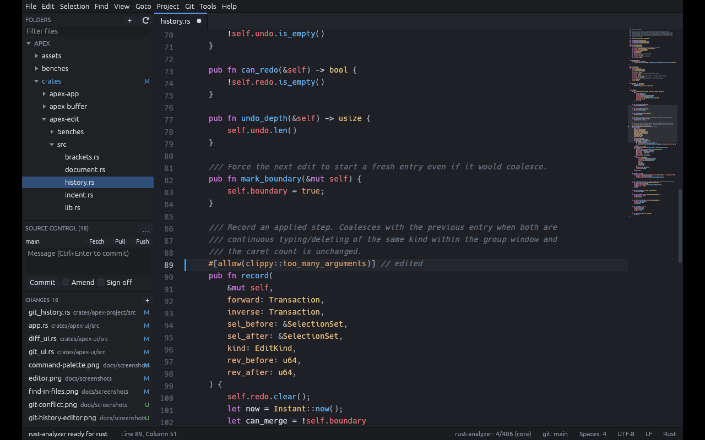
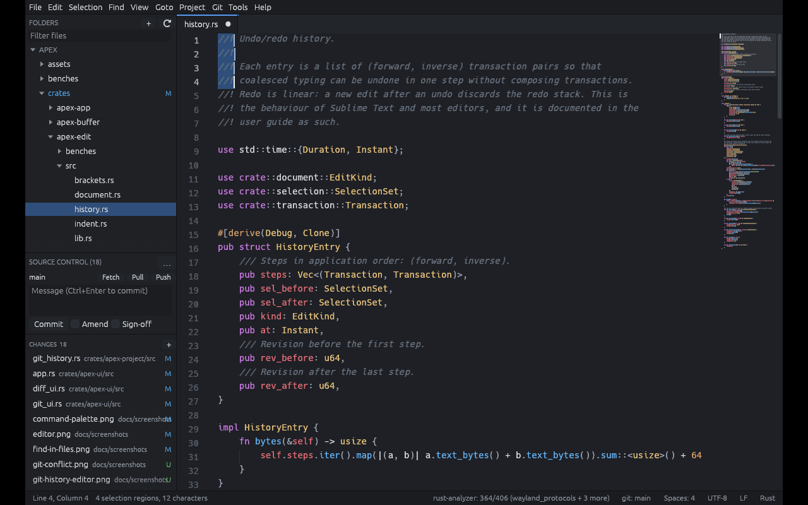
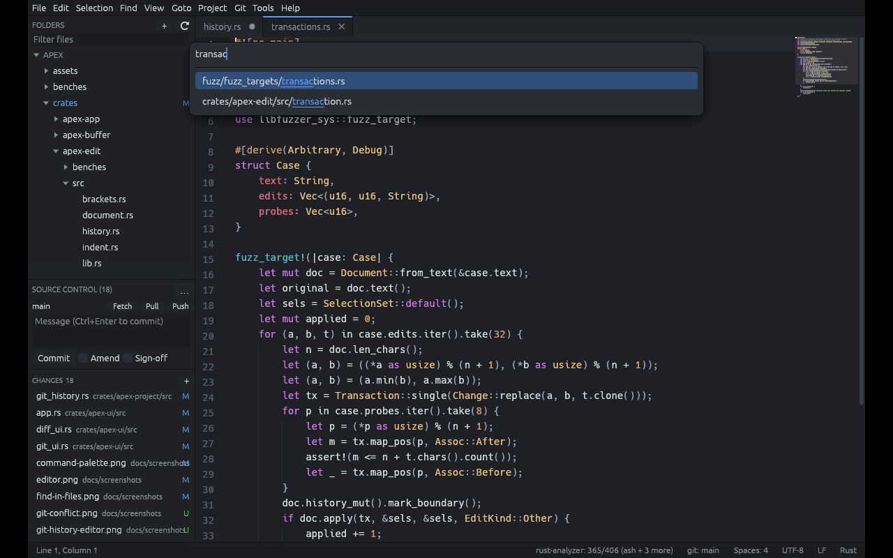
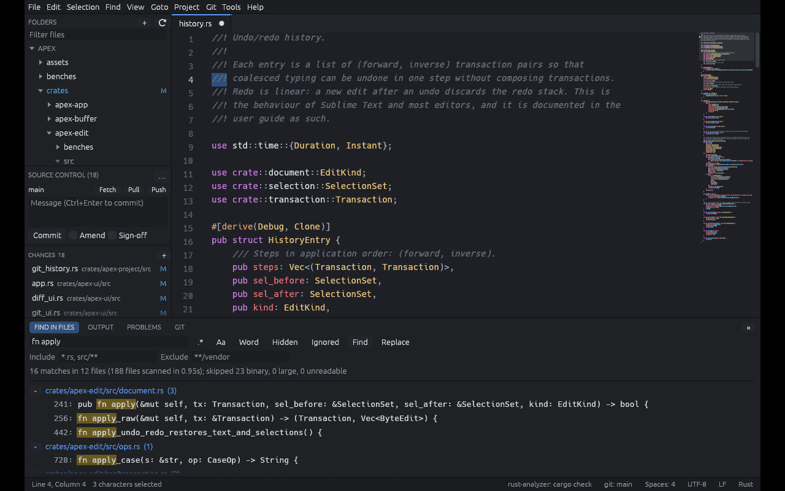
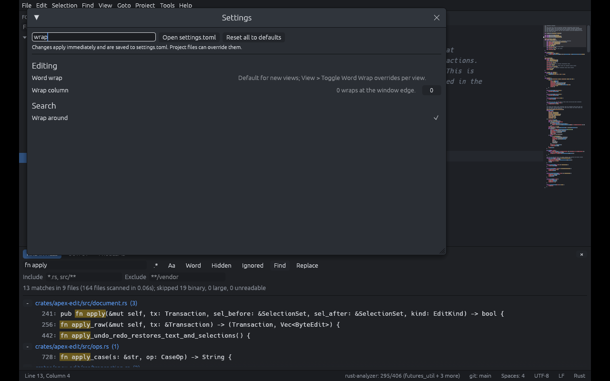
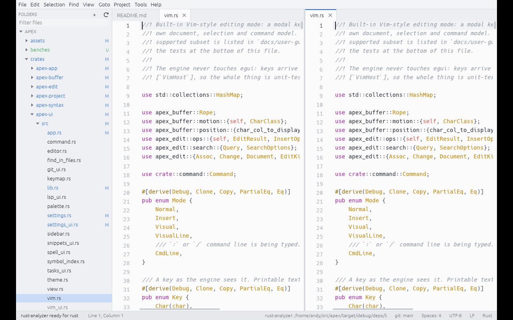
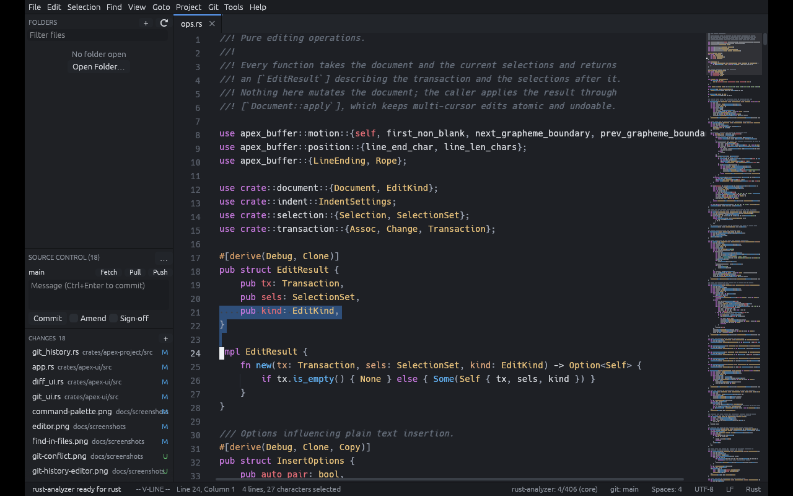

# Apex

Apex is a native, high-performance text editor written in Rust with an
egui/eframe interface. It is inspired by Sublime Text's responsiveness and
workflow: instant start-up, excellent multi-cursor editing, powerful search
and navigation, configurable themes and key bindings, and careful handling
of your files. It runs on Linux (X11 and Wayland), Windows 10/11 and macOS.

Apex is deliberately a text editor, not an IDE: there is no plugin system (yet),
no scripting runtime (yet), no telemetry, no account and no network dependency.
Everything works offline.



> Status: 0.1, pre-release. `FEATURE_MATRIX.md` lists every feature with its
> verification status; `PROGRESS.md` is the milestone log with real test
> results; `CHANGELOG.md` tracks releases.

## Features

* **Editing engine**: rope buffer, viewport-only layout with caching,
  Unicode-correct carets (grapheme clusters, wide characters, tabs, bidi-safe
  motions), transactional multi-cursor editing with coalescing undo/redo,
  auto-pairing, smart indentation, snippets with tab stops.
* **Multiple cursors**: Ctrl+click, Ctrl+D quick-add and skip, select all
  occurrences, split into lines, add above/below, column selection, paste one
  line per cursor, undo selection changes.
* **Syntax**: incremental tree-sitter highlighting for 30 languages with
  injections (Markdown code fences, HTML script/style), folding, symbols,
  bracket matching, indentation guides, minimap.
* **Search**: incremental find/replace with regex, whole word, case and
  in-selection modes; project-wide Find and Replace in Files with gitignore
  and glob filters, streamed results and atomic writes.
* **Navigation**: Goto Anything (files, `:line`, `@symbol`, `#project symbol`,
  `>command`), command palette, jump history, breadcrumbs, bookmarks.
* **Workspace**: lazy project explorer for huge trees, file watcher, tabs
  with drag/pin/preview, split panes (columns, rows, grid, nested), several
  views of one file, sessions and crash recovery, project files.
* **Files**: encodings (UTF-8/16, Windows-125x, ISO-8859, CJK) and line
  endings detected, converted and preserved; atomic saves that never
  overwrite a file another program changed; large-file mode; hex preview.
* **Git**: gutter marks, branch in the status bar, hunk navigation, revert
  hunk, compare with index/HEAD/saved, file history, status palette.
* **Build tasks** with trust gating, problem matchers and a Problems panel.
* **Language servers** (optional): completion, diagnostics, hover, signature
  help, go to definition/references, rename, code actions, formatting.
* **Customisation**: searchable settings editor, layered TOML settings, key
  map with chords and platform sections, eight built-in themes plus TOML
  user themes, snippets, spell checking with Hunspell dictionaries.
* **Modes**: distraction-free, zen, low-distraction, fullscreen, and a
  built-in Vim mode (normal/insert/visual/visual-line, operators, text
  objects, registers, `.`, `:` commands).
* **Command line**: `apex file.rs:120:8`, `apex .`, single instance with
  `--new-window`, `--wait` for use as `$EDITOR`, `--diff old new`.

| | |
|---|---|
|  |  |
|  |  |
|  |  |

## Installation

Packages are built by the scripts under `packaging/` (see
[Packaging](#packaging)). From a release archive:

* **Linux**: `tar xzf apex-*-linux-*.tar.gz && cd apex-*/ && ./install.sh`
  (user install into `~/.local`), or `sudo apt install ./apex_*_amd64.deb`,
  or run the AppImage.
* **macOS**: open the DMG and drag Apex to Applications. Finder's
  **Open With** lists Apex for any file.
* **Windows**: run the installer (optional Explorer "Open with Apex",
  file associations and PATH entry) or unzip the portable build.

## Building from source

Requirements: stable Rust 1.91 or newer (edition 2024) and a C compiler
(for tree-sitter grammars and libgit2). On Linux you also need the
windowing development packages:

```sh
# Debian/Ubuntu
sudo apt install build-essential pkg-config libxkbcommon-dev libwayland-dev \
     libxcb-render0-dev libxcb-shape0-dev libxcb-xfixes0-dev
# Fedora
sudo dnf install gcc pkg-config libxkbcommon-devel wayland-devel libxcb-devel
```

```sh
cargo build --release
./target/release/apex path/to/file.rs
```

`make build`, `make test`, `make lint`, `make fmt`, `make check` and
`make bench` wrap the cargo invocations; `make release` builds the release
binary and then packages it for the current platform (`Apex.app` and a DMG
on macOS, tarball and `.deb` on Linux) into `dist/`.
Tests, lint and format checks must pass before a commit:

```sh
cargo fmt --all -- --check
cargo clippy --workspace --all-targets -- -D warnings
cargo test --workspace
```

## Running

```
apex                          open, or focus the running editor
apex file.rs                  open a file (in the running editor if any)
apex file.rs:120:8            open at line 120, column 8
apex .                        open a folder as a workspace
apex --new-window file.rs     a separate instance
apex --wait file.rs           return when the tab closes (EDITOR="apex --wait")
apex --diff old.rs new.rs     unified diff of two files
apex --version | --help
```

The [user guide](docs/user-guide/README.md) covers navigation, editing,
search, projects, configuration, git, build tasks, language servers, Vim
mode and troubleshooting.

## Keyboard shortcuts (defaults for Linux and Windows; Cmd for Ctrl on macOS)

| Action | Keys |
|---|---|
| Goto Anything / command palette | Ctrl+P / Ctrl+Shift+P |
| Go to line / symbol / project symbol | Ctrl+G / Ctrl+R / Ctrl+Shift+R |
| Find / Replace / Find in Files | Ctrl+F / Ctrl+H / Ctrl+Shift+F |
| Quick add next occurrence / all | Ctrl+D / Alt+F3 |
| Add cursor above/below | Alt+Shift+Up / Down |
| Column selection | Ctrl+Shift+Alt+Up / Down |
| Split selection into lines | Ctrl+Shift+L |
| Expand to line / brackets / scope | Ctrl+L / Ctrl+Shift+M / Ctrl+Shift+A |
| Duplicate / delete line | Ctrl+Shift+D / Ctrl+Shift+K |
| Move line up / down | Ctrl+Shift+Up / Down |
| Toggle comment | Ctrl+/ |
| Undo / redo | Ctrl+Z / Ctrl+Shift+Z |
| Completion / format | Ctrl+Space / Ctrl+Shift+I |
| Build / select task / cancel | Ctrl+B / Ctrl+Shift+B / Ctrl+Shift+C |
| Go to definition / references | F12 / Shift+F12 |
| Split pane; layouts | Ctrl+\ ; Alt+Shift+1, 2, 3, 8, 5 |
| Switch tabs | Ctrl+PgUp / PgDn, Ctrl+1…9 |
| Sidebar / minimap / word wrap | Ctrl+K Ctrl+B / Ctrl+K Ctrl+M / Ctrl+K Ctrl+W |
| Zoom | Ctrl+= / Ctrl+- / Ctrl+0 |
| Fullscreen / distraction-free / zen | F11 / Shift+F11 / Ctrl+K Ctrl+Z |
| Settings / shortcuts | Ctrl+, / Ctrl+K Ctrl+S |

The full list is in `assets/keymap-default.toml`; **Tools > Keyboard
Shortcuts** shows the effective bindings.

## Packaging

```
packaging/icons/generate.sh      SVG → PNG sizes, .icns, .ico (librsvg or ImageMagick)
packaging/linux/build.sh         tarball + install.sh, .deb, AppImage (if appimagetool)
packaging/macos/build.sh         Apex.app (document types, ad hoc signature) + DMG
packaging/windows/build.ps1      portable zip + Inno Setup installer
packaging/package.sh             the one for the current platform, into ./dist
```

Signing and notarisation steps are in `packaging/macos/README.md`.

## Documentation

* `docs/user-guide/` — using the editor
* `ARCHITECTURE.md` — crates, document model, rendering and input pipelines,
  worker model, persistence, security boundaries
* `docs/development/` — manual smoke test, adding grammars and commands,
  release process
* `benches/README.md` and `docs/performance/benchmarks.md` — benchmarks and
  measured results
* `docs/security/` — file-handling guarantees and the security review
* `CONTRIBUTING.md`, `SECURITY.md`, `CHANGELOG.md`

## Licence

Apex is licensed under the GNU Affero General Public License, version 3.0 or
later. See `LICENSE`. All dependencies are under compatible permissive
licences (MIT, Apache-2.0, BSD, Zlib, OFL for fonts). Bundled fonts are those
shipped with egui (Hack — MIT/Bitstream Vera; Ubuntu — Ubuntu Font Licence;
Noto Emoji — OFL; emoji-icon-font — MIT). The application icon
(`assets/icons/apex.svg`) is part of this project and under the same licence.
